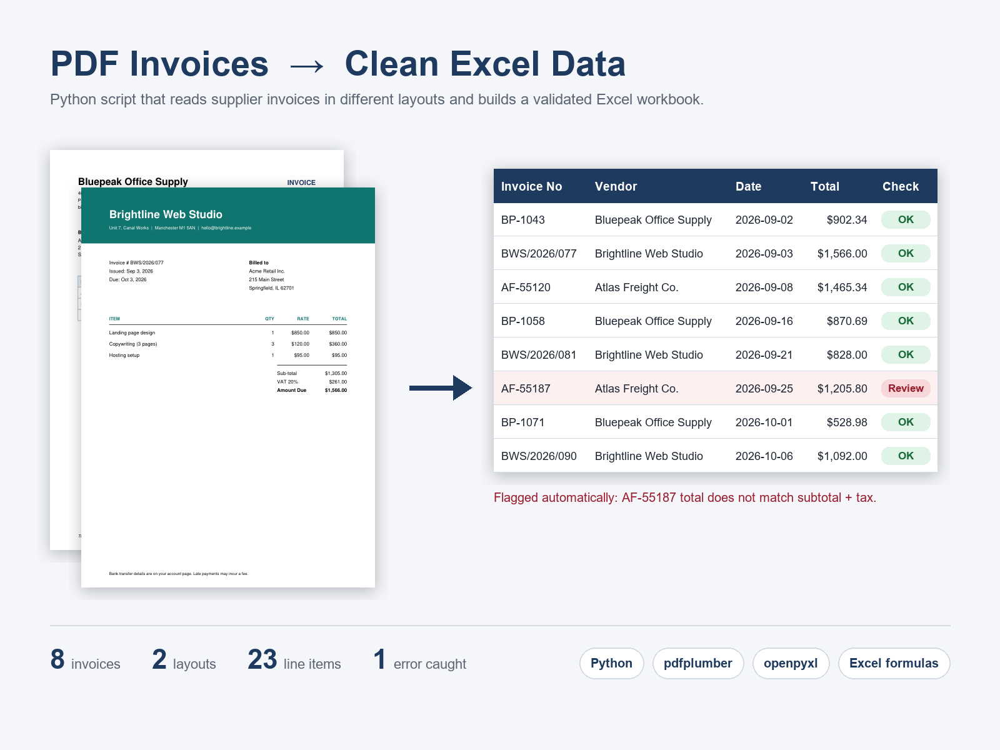

# PDF Invoices → Clean Excel Data

A Python script that reads a folder of supplier invoices (PDF) and builds a clean,
validated Excel workbook — no more copying numbers by hand.



## What it does

- Reads every PDF in a folder and extracts **vendor, invoice number, issue date,
  due date, line items, subtotal, tax and total**.
- Handles **different invoice layouts**: label variants (`Invoice No:` / `Invoice #`,
  `Total` / `Amount Due`, `Tax` / `VAT`), several date formats and tables with or
  without grid lines.
- Writes an Excel workbook with three sheets:
  - **Invoices** – one row per invoice, with live formula checks
  - **Line Items** – every line from every invoice, ready for pivot tables
  - **By Vendor** – invoice count, total billed and items needing review per vendor
- **Validates every invoice** with Excel formulas: line items must add up to the
  subtotal, and subtotal + tax must equal the total. Mismatches are highlighted in
  red so nothing slips through.

In the included sample, 8 invoices from 3 vendors (2 layouts) are processed and one
invoice with a wrong printed total is flagged automatically.

## Run it

```bash
pip install -r requirements.txt
python extract_invoices.py --input sample_invoices --output output/invoices.xlsx
```

```
BP-1043.pdf            Bluepeak Office Supply   BP-1043        3 items  total     902.34  OK
BWS-2026-077.pdf       Brightline Web Studio    BWS/2026/077   3 items  total   1,566.00  OK
...
AF-55187.pdf           Atlas Freight Co.        AF-55187       2 items  total   1,205.80  REVIEW
```

To regenerate the sample PDFs: `python generate_sample_invoices.py`

## How it works

1. `pdfplumber` extracts the text and word positions from each page.
2. The vendor name is detected as the largest text on the page.
3. Regular expressions pick out labelled fields, dates and line-item rows.
4. `openpyxl` writes the workbook with formatting, filters, frozen headers,
   `SUMIFS`/`COUNTIFS` summaries and conditional formatting.

Adapting it to new invoice formats usually means adding a label or date format to
the patterns at the top of `extract_invoices.py`. Scanned (image-only) PDFs need an
OCR step first, which can be added.

## Files

| File | Purpose |
|---|---|
| `extract_invoices.py` | The extractor |
| `generate_sample_invoices.py` | Creates the sample PDFs |
| `sample_invoices/` | 8 sample invoices |
| `output/invoices.xlsx` | Generated workbook |

All companies and figures in the sample invoices are fictional.
